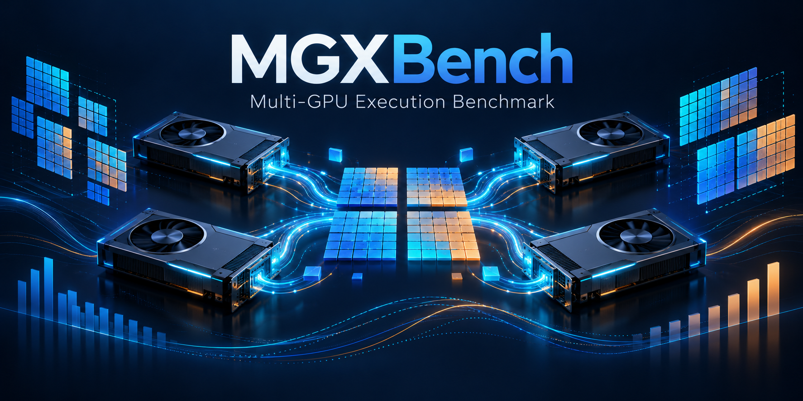
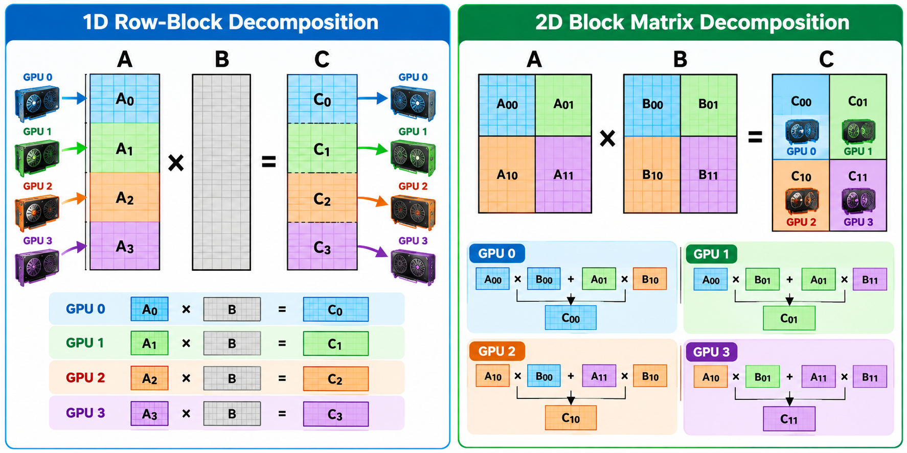
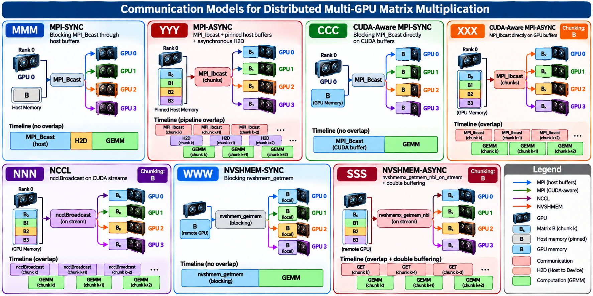

<div align="center">
  

  [](https://github.com/muriloboratto/MGXBench/actions/workflows/python-tests.yml)
  [](https://github.com/muriloboratto/MGXBench/actions/workflows/cmake-validation.yml)
  
  
  
  
</div>

# Multi-GPU Execution Benchmark and Communication Performance

MGXBench is a C++/CUDA benchmarking framework for studying and optimizing **distributed dense matrix multiplication across NVIDIA GPUs**. It evaluates how matrix decomposition, communication backends, and communication–computation overlap affect performance on single- and multi-node HPC systems.

MGXBench supports **1D Row-Block** and **2D Block/SUMMA** decomposition, compares seven implementations based on MPI, CUDA-aware MPI, NCCL, and NVSHMEM, and provides a **predictive autotuner** that estimates execution times and selects among previously calibrated configurations without exhaustively running every candidate at the target problem size.

## Contents

- [Benchmark design](#benchmark-design)
- [Domain decomposition](#domain-decomposition)
- [Communication models](#communication-models)
- [Repository structure](#repository-structure)
- [Get Started](#-get-started)
  - [Initialization Modules](#️-initialization-modules)
  - [Installation](#-installation)
  - [Running](#️-running)
    - [1D Row-Block](#1d-row-block)
    - [2D Block/SUMMA](#2d-blocksumma)
    - [Main command-line arguments](#main-command-line-arguments)
  - [Outputs and performance metrics](#-outputs-and-performance-metrics)
  - [Documentation and tutorials](#documentation-and-tutorials)
  - [Validation](#-validation)
  - [Cleaning the build](#-cleaning-the-build)
  
## Benchmark design

MGXBench evaluates two complementary dimensions of distributed GPU execution:

- **Domain decomposition:** how matrices are partitioned and assigned to GPUs.
- **Communication model:** how matrix data is transferred and whether communication can overlap GPU computation.

The workload is dense matrix multiplication, $C = A × B$, with square matrices of order $N$. The Python runner (`benchmark.py`) orchestrates repeated runs of the CUDA executables, records timings and validation results, and exports CSV/JSON summaries.

## Domain decomposition



## Communication models



The benchmark exposes the following library identifiers through `--libraries`:

| ID | Model | Main communication mechanism | Chunking | Intended overlap |
|:--:|---|---|---|---|
| `MMM` | **MPI-SYNC** | Blocking `MPI_Bcast` via host buffers | No | None |
| `YYY` | **MPI-ASYNC** | `MPI_Ibcast`, pinned host buffers, asynchronous host-to-device transfers | A and B | Communication / H2D / GEMM pipeline |
| `CCC` | **CUDA-Aware-SYNC** | Blocking `MPI_Bcast` directly on CUDA buffers | No | None |
| `XXX` | **CUDA-Aware-ASYNC** | `MPI_Ibcast` directly on GPU buffers | B | B communication / GEMM |
| `NNN` | **NCCL** | `ncclBroadcast` on CUDA streams | B | B communication / GEMM |
| `WWW` | **NVSHMEM-SYNC** | Blocking `nvshmem_getmem` | No | None |
| `SSS` | **NVSHMEM-ASYNC** | `nvshmemx_getmem_nbi_on_stream` and double buffering | B | NVSHMEM GET / GEMM |

The terms *asynchronous* and *overlap* describe the implementations' **intended behavior**. Actual overlap depends on the hardware, runtime, synchronization, and problem size, and should be verified experimentally.

##  Repository structure

```text
MGXBench/
├── 1D-row-block/
│   ├── mmb.cu
│   ├── mulmat_kernel.cu
│   └── README.md
│
├── 2D-block-matrix/
│   ├── mmb.cu
│   ├── mulmat_kernel.cu
│   └── README.md
│
├── configuration/
│   ├── experiment.py
│   ├── run_campaign.py
│   ├── plot_benchmark.py
│   ├── plot_nsys_stats.py
│   └── requirements-viz.txt
│
├── autotuning/
│   ├── predictive.py
│   └── models/          
│
├── tools/
│   ├── profile_rank.sh
│   └── stats_rank.sh
│
├── tests/
│   ├── test_workflow.py
│   ├── test_configuration_layout.py
│   ├── test_nsys_stats.py
│   └── test_v5_scope.py
│
├── examples/
├── notebooks/
├── img/
├── benchmark.py
├── CMakeLists.txt
├── install.sh
├── README.md
└── GUIDE.md      
```

The `build/` and `results/` directories are created locally and are not required in the source distribution.

## 🚀 Get Started

### ⚙️ Initialization Modules

```bash
[username ~]$ module load anaconda3/2020.07_sequana 
[username ~]$ module load nvshmem/3.1.7_cuda-11.2_sequana
[username ~]$ module load cmake/3.30.3_sequana
[username ~]$ module load gcc/9.3_sequana
[username ~]$ module load cuda/11.2_sequana
[username ~]$ module load openmpi/gnu/4.1.4+cuda-11.2_sequana
[username ~]$ module load nccl/2.13_cuda-11.2_sequana
```

### 📦 Installation

MGXBench requires a compatible NVIDIA CUDA toolkit, C++ compiler, CMake, MPI, NCCL, NVSHMEM, and Python environment. On a cluster, load the modules supplied by your site before building. The easiest way to try MGXBench using the following commands:

```bash
# get the code
[username ~]$ git clone https://github.com/muriloboratto/MGXBench.git
[username ~]$ cd MGXBench

# start the installation
[username ~]$ bash install.sh
```

### ▶️ Running 

**Run within a GPU allocation**, following the cluster scheduler's policies. For the examples below, request **four visible GPUs on one node**. The current execution setup associates ranks with GPU indices on the same node.

#### `1D Row-Block` 

```bash
[username ~]$ python3 benchmark.py \
              --decomposition 1d \
              --size 4096 \
              --ranks 4 \
              --libraries MMM YYY CCC XXX NNN WWW SSS \
              --warmup 2 --repeats 3 \
              --plot \
              --output results/1d
```

#### `2D Block/SUMMA`

```bash
[username ~]$ python3 benchmark.py \
              --decomposition 2d \
              --size 4096 \
              --ranks 4 \
              --grid-rows 2 \
              --grid-cols 2 \
              --libraries MMM YYY CCC XXX NNN WWW SSS \
              --warmup 2 --repeats 3 \
              --plot \
              --output results/2d
```

#### Main command-line arguments

| Argument | Purpose |
|---|---|
| `--decomposition` | Select `1d` or `2d` |
| `--size` | Matrix dimension **N** (for an N × N problem) |
| `--ranks` | Number of MPI ranks / participating GPUs |
| `--grid-rows` | Specifies the number of process rows in the 2D grid |
| `--grid-cols` | Specifies the number of process columns in the 2D grid |
| `--libraries` | Communication implementations to evaluate; use `AUTO` alone for prediction |
| `--prediction-model` | With `AUTO`: `extrapolation` (default), `ml` (Ridge), or `auto` |
| `--grid-rows`, `--grid-cols` | Explicit SUMMA grid; with `AUTO`, restrict the candidate grid |
| `--summa-bk` | SUMMA panel width for measured runs; AUTO selects BK from calibrated candidates |
| `--warmup` | Warm-up runs before recorded measurements |
| `--repeats` | Number of recorded runs per implementation |
| `--output` | Destination directory for reports |
| `--build-dir` | Directory containing `mm_1d` and `mm_2d` |
| `--launcher` | MPI launcher executable (default: `mpirun`) |
| `--launcher-args` | Additional launcher arguments |
| `--plot` | Generate figure and table with the experimental results |
| `--timeout` | Execution timeout in seconds |

###  📊 Outputs and performance metrics

```text
results/sweep-4gpus/
├── runs/
│   └── <identificador>/
│       ├── benchmark.csv
│       ├── benchmark.json
│       └── <logs de execução>
└── report/
    ├── report.html
    ├── report.md
    ├── summary.csv
    └── <figures PNG and PDF>
```

### 📚 Documentation and tutorials

- **[User Guide](GUIDE.md):** installation, benchmark campaigns, SLURM, profiling, visualization, scaling, and predictive autotuning.
- **[1D implementation](1D-row-block/README.md):** row-block matrix decomposition and implementation details.
- **[2D implementation](2D-block-matrix/README.md):** block decomposition and SUMMA execution.
- **[Notebooks](notebooks/):** sample environment configurations and supporting resources.
- **[Tests](tests/):** automated workflow and configuration checks.

For hands-on experimentation, follow the command sequences in the user guide within an appropriately allocated HPC environment. GPU/MPI benchmark commands require a compatible cluster; they are not expected to execute on a CPU-only notebook session.


### 🧩 Validation

```bash
[username ~]$ python3 -m unittest discover -s tests -v
```

### ✅ Cleaning the build

Remove compiled objects and binaries while retaining the CMake configuration:

```bash
[username ~]$ cmake --build build --target clean
```

---

<div align="center">
  <strong>MGXBench</strong> · Distributed GPU computing · Communication performance · Predictive Autotuning
</div>
