# MGXBench Performance Report

- Only numerically validated measurements are plotted.
- Bars show means ± population standard deviation. CI95 is a seeded percentile bootstrap of independent launches (2,000 resamples); small samples give uncertain intervals.
- GFLOP/s is effective application throughput: 2 N³ / elapsed time. No hardware-counter or isolated-kernel claim.
- Identical environment, label and internal-loop count are required for comparisons. Repeated matching runs pool raw launch samples.
- 1D and 2D timed regions retain their original algorithm-specific scope. Equal internal-loop count does not make their communication work identical.
- Matrix-size curves describe workload growth; strong scaling fixes N. Weak scaling for dense MM holds N³/p approximately constant, not N²/p.
- Kernel and application totals do not identify concurrent phases. This release provides benchmark summaries and kernel statistics only.

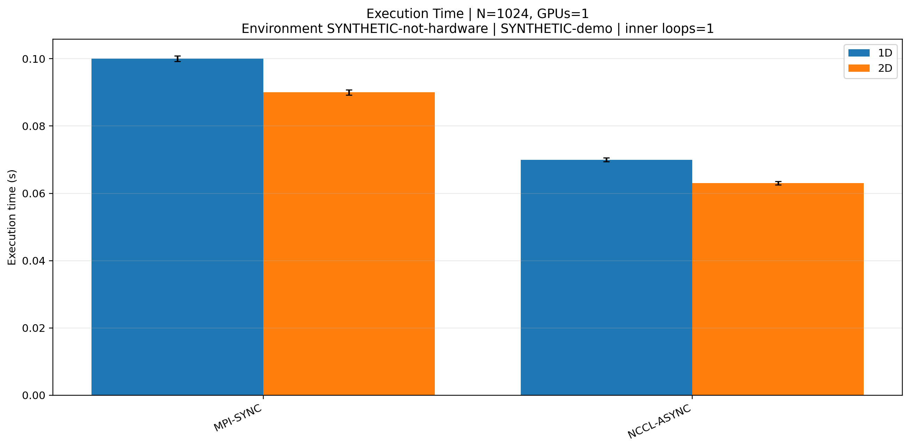

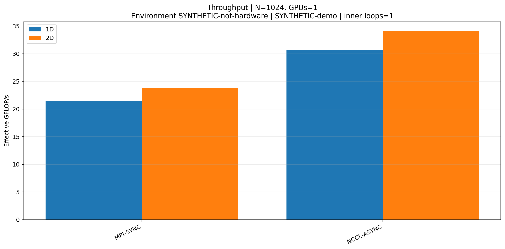

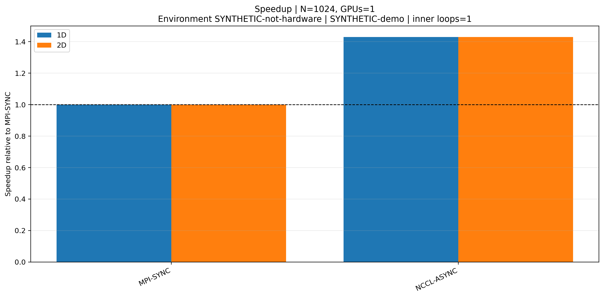

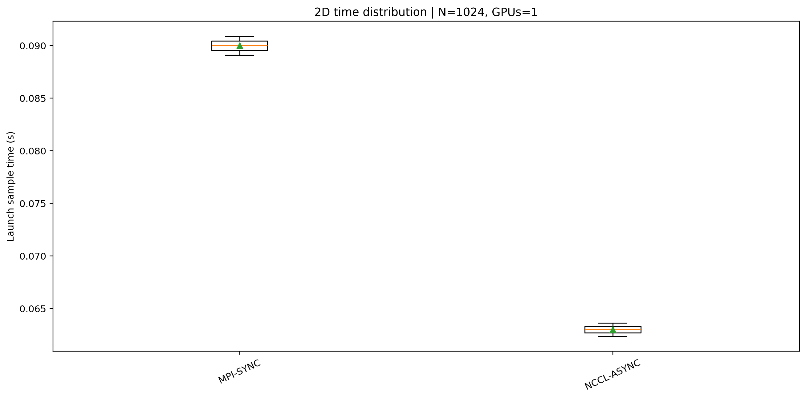

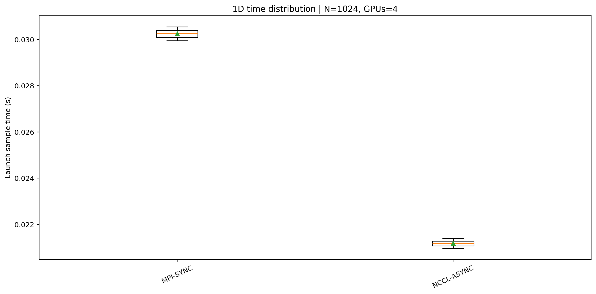

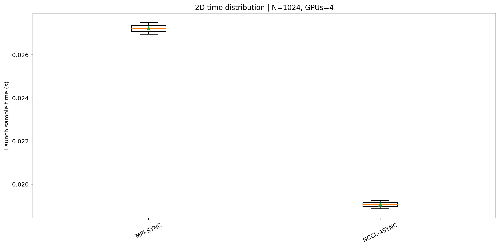

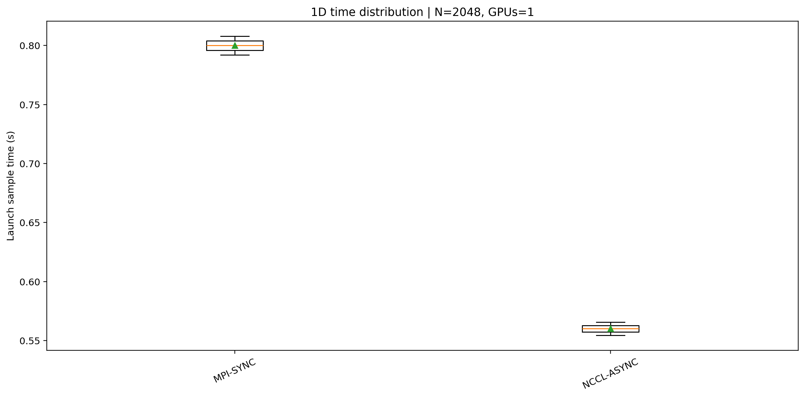

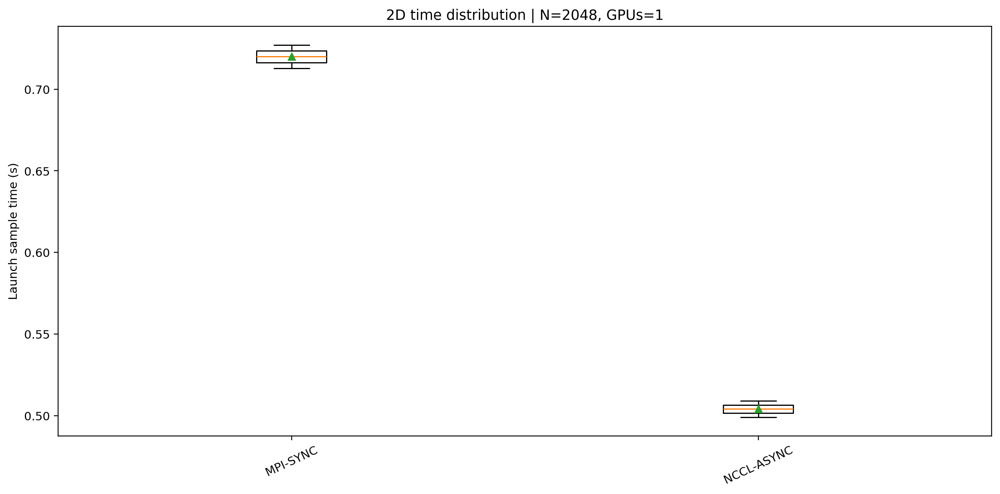

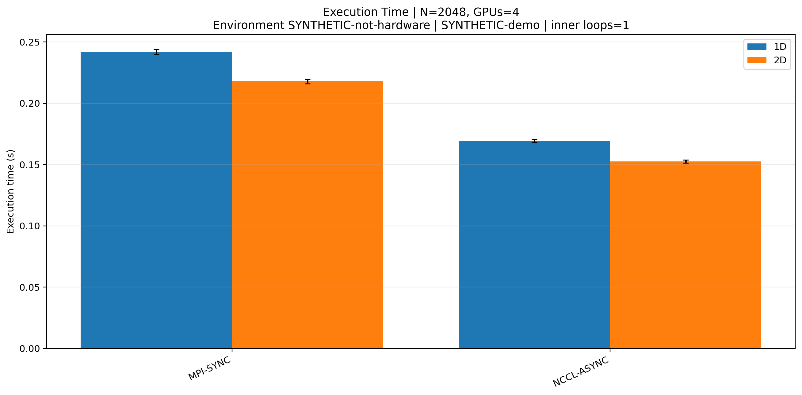

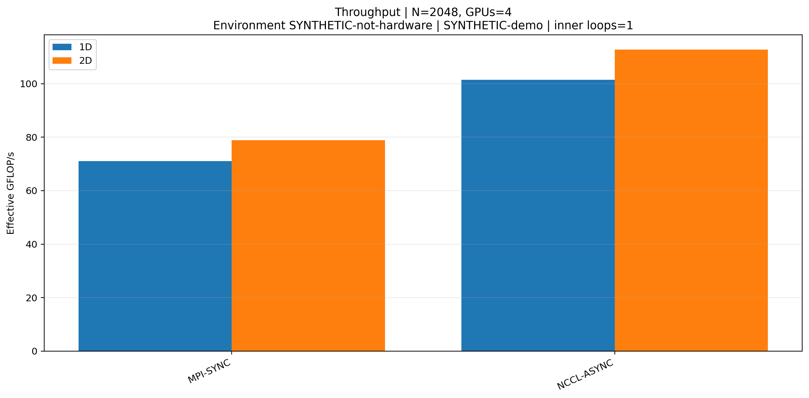

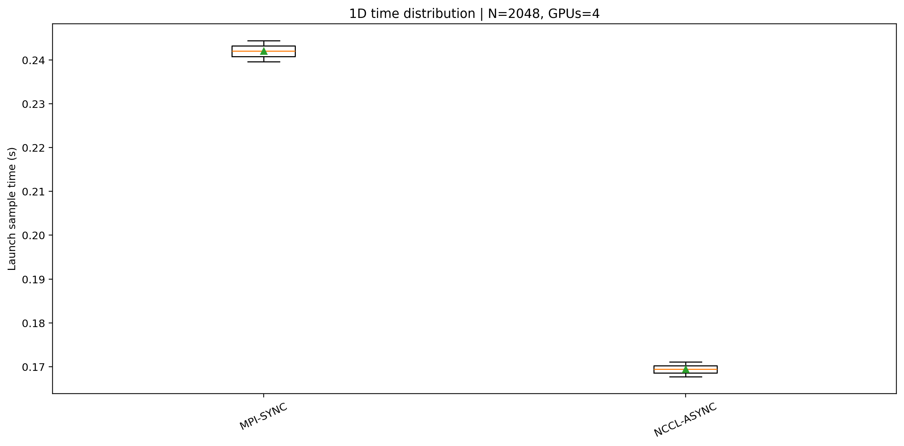

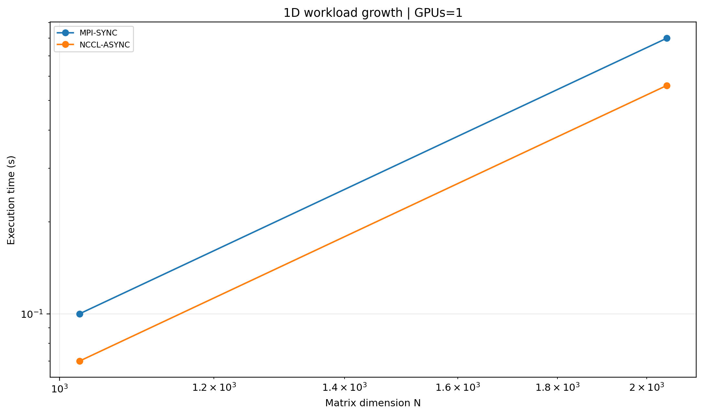

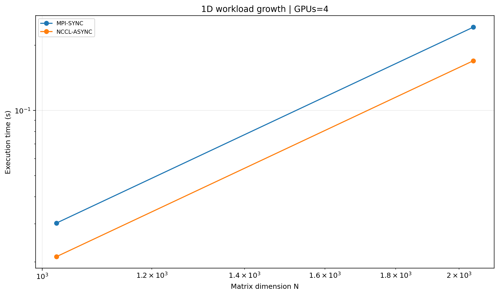

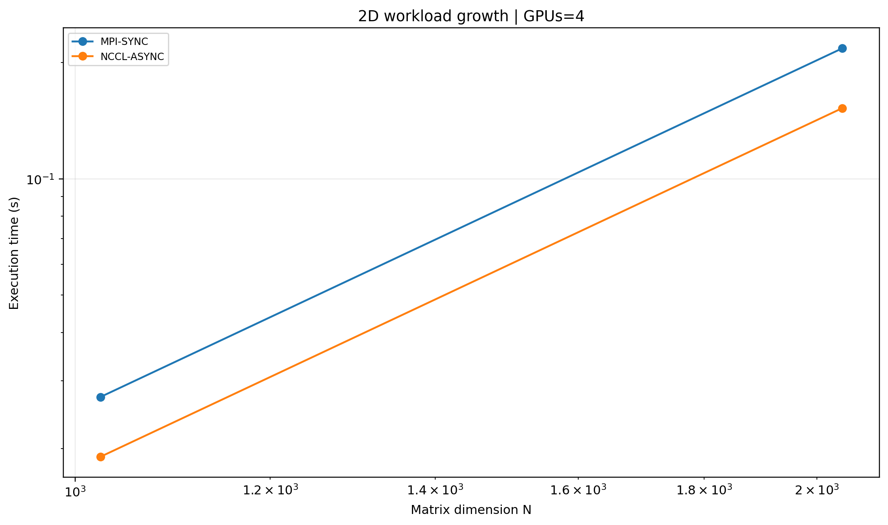

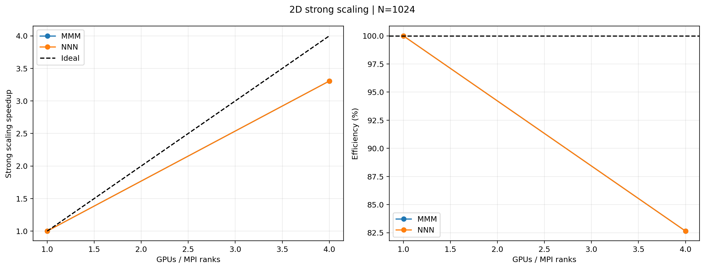

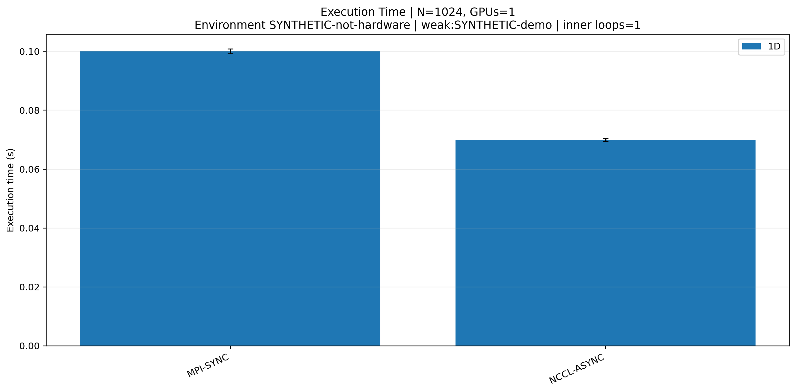

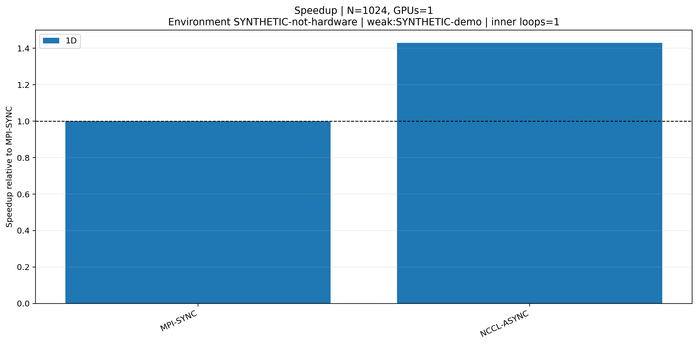

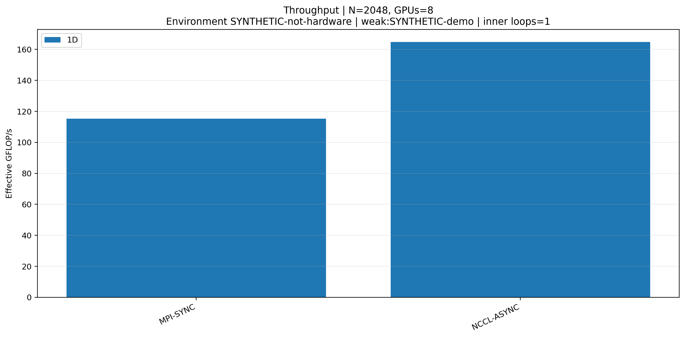

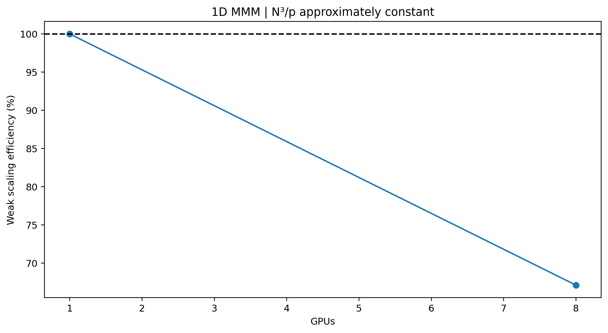

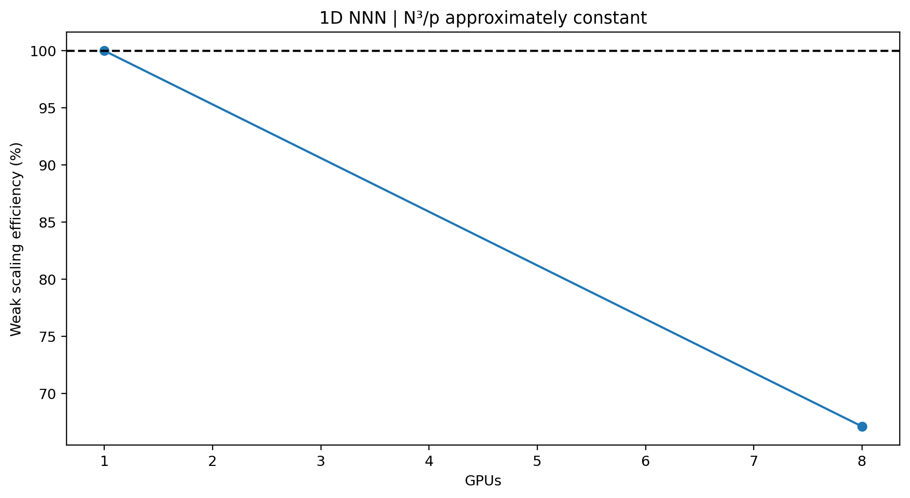